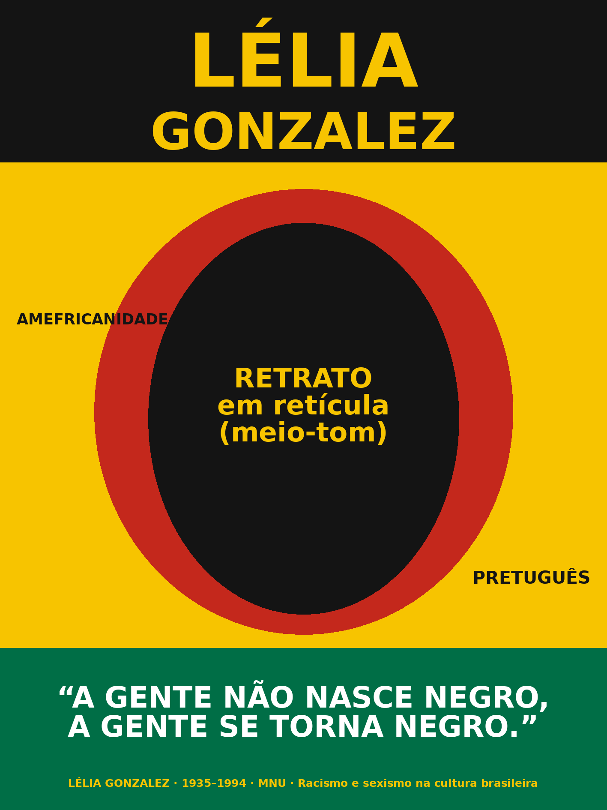
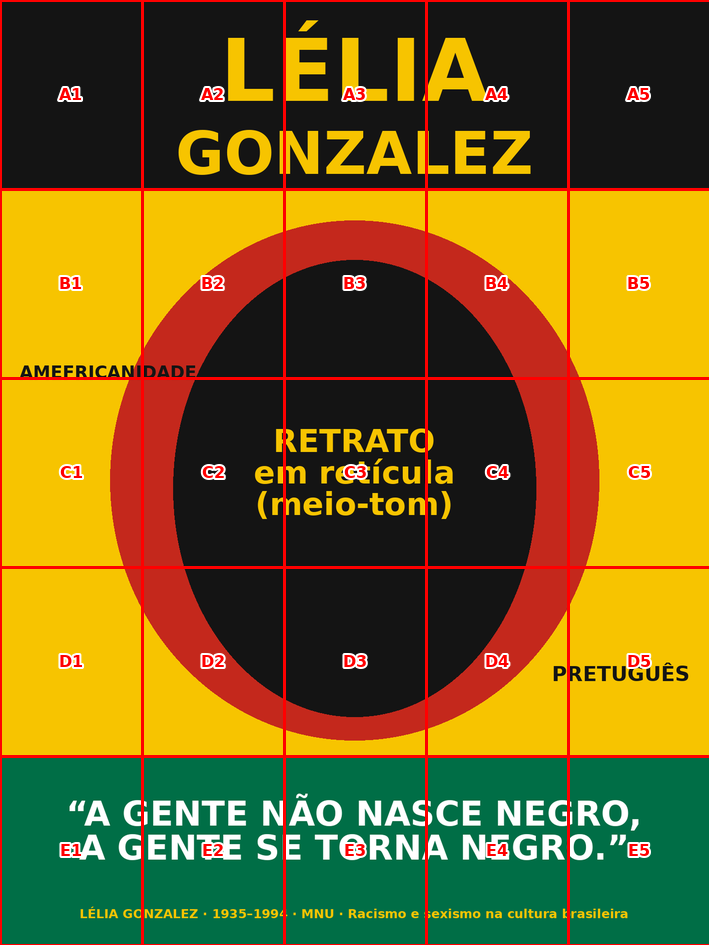

# Lambe-lambe — Lélia Gonzalez (tela 90 × 120 cm em 25 folhas A4)



> O `esboco.png` é só um esquema de layout: blocos de cor e posição dos textos.
> O retrato de verdade entra no lugar da elipse preta.

## 1. A ideia

**Conceito:** um cartaz de rua (lambe-lambe) que apresenta Lélia Gonzalez
(1935–1994), filósofa, antropóloga e cofundadora do Movimento Negro Unificado
(MNU, 1978), por meio de três ideias dela que funcionam bem como palavra de
muro:

| Elemento | Conteúdo | Por quê |
|---|---|---|
| Título (faixa preta, linha A) | **LÉLIA GONZALEZ** em letra bem grossa, amarela | Nome grande, legível a 10 m, no estilo dos cartazes de tipografia popular |
| Retrato (centro, linhas B–D) | Rosto de Lélia em **retícula / meio-tom** (pontos pretos), dentro de uma moldura vermelha | Retícula é a linguagem gráfica do lambe-lambe e aguenta bem impressão doméstica e emendas de folha |
| Palavras soltas | **AMEFRICANIDADE** e **PRETUGUÊS** | Conceitos dela: a experiência comum dos povos negros e indígenas nas Américas e o português marcado pelas línguas africanas |
| Frase (faixa verde, linha E) | **“A gente não nasce negro, a gente se torna negro.”** | A frase dela mais citada, curta e direta |
| Rodapé | `Lélia Gonzalez · 1935–1994 · MNU · Racismo e sexismo na cultura brasileira` | Dá a referência para quem quiser ler mais |

**Paleta:** amarelo `#F7C400`, preto `#141414`, vermelho `#C4281C`, verde
`#006E46`. Poucas cores chapadas, bem contrastantes: emendas de papel ficam
menos visíveis e qualquer impressora resolve bem.

**Alternativas de frase** (troque se o grupo preferir):

- “O lixo vai falar, e numa boa.” (*Racismo e sexismo na cultura brasileira*, 1984)
- “Cumé que a gente fica?” (abertura do mesmo texto)

**Retrato:** fotografias de Lélia têm direitos autorais. O mais seguro é
**desenhar** o retrato (à mão ou vetorizado) a partir de várias referências,
ou usar uma foto com licença livre e dar o crédito. Depois, aplique o efeito
de retícula (Photoshop: *Filtro → Pixelizar → Meio-tom em cores*; GIMP:
*Filtros → Distorções → Jornal*; Photopea faz o mesmo de graça no navegador).

## 2. A conta das folhas (por que 5 × 5)

A tela tem proporção **3:4** (90 ÷ 120). Dividindo em 5 colunas e 5 linhas,
cada pedaço mede **18 × 24 cm**, também 3:4, e cabe numa A4 em pé
(21 × 29,7 cm) com folga para:

- a margem que a impressora não imprime (~0,5 cm);
- **1 cm de aba** à direita e embaixo, que fica escondida sob a folha vizinha.
  É isso que evita frestas brancas entre as folhas.

```
Tela 90 × 120 cm           Cada folha A4 (retrato)
┌──┬──┬──┬──┬──┐           ┌─────────────────────┐
│A1│A2│A3│A4│A5│  24 cm    │  ┌──────────────┬─┐ │
├──┼──┼──┼──┼──┤           │  │              │a│ │
│B1│B2│B3│B4│B5│           │  │  18 × 24 cm  │b│ │
├──┼──┼──┼──┼──┤           │  │   (imagem)   │a│ │
│C1│C2│C3│C4│C5│           │  ├──────────────┘ │ │
├──┼──┼──┼──┼──┤           │  │     aba 1 cm   │ │
│D1│D2│D3│D4│D5│           │  └────────────────┘ │
├──┼──┼──┼──┼──┤           │  B2  linha B, col 2 │
│E1│E2│E3│E4│E5│           └─────────────────────┘
└──┴──┴──┴──┴──┘
 18 cm cada
```

Total: **25 folhas**, e cada uma traz o nome (A1…E5) e um minimapa
impressos. As emendas caem em 18, 36, 54 e 72 cm na horizontal e em 24, 48,
72 e 96 cm na vertical. Na arte final, **evite pôr olhos, boca ou letras
pequenas exatamente sobre essas linhas** (veja `mapa_montagem.png`).



## 3. Preparar a arte final

1. Monte a arte em **9000 × 12000 px** (≈ 254 dpi), ou no mínimo
   **5315 × 7087 px** (150 dpi). Canva, Photopea, Illustrator e Inkscape
   servem. Configure o documento como 90 × 120 cm.
2. Exporte em PNG ou JPG de alta qualidade.
3. Gere as folhas:

```bash
pip install pillow
python3 fatiar_a4.py arte_final.png            # gera lambe_lambe_A4.pdf (25 páginas) + mapa_montagem.png
python3 fatiar_a4.py arte_final.png --dpi 300  # mais nitidez, PDF maior
python3 fatiar_a4.py --esboco                  # recria o esboço de layout
```

O script recorta tudo com precisão de pixel. Se a imagem não estiver em 3:4,
ele avisa e corta as sobras pelo centro.

> Sem Python? Dá para fazer o mesmo com o *Posterazor* (grátis) ou com a
> opção "Pôster" do Adobe Reader. Use folha A4, sobreposição de 1 cm e grade
> 5 × 5. O script deste repositório tem a vantagem de numerar as folhas e
> deixar as abas só à direita e embaixo.

## 4. Imprimir sem erro de escala

- No diálogo de impressão: **Tamanho real / 100 % / Sem ajuste**. Nunca use
  “Ajustar à página”, que encolhe cada folha um pouco e desalinha a imagem.
- **Teste antes:** imprima só uma folha e meça a imagem com régua. Deve dar
  **18 cm** de largura **sem a aba** (19 cm com ela). Se der diferente, a
  escala está errada.
- Prefira **impressora a laser** (ou gráfica rápida). Tinta de jato de tinta
  borra com cola molhada. Se for jato de tinta, espere secar bem e passe uma
  demão de spray fixador/verniz antes de colar.
- Papel: sulfite **75–90 g/m²**. Papel mais fino absorve a cola e assenta
  melhor na tela do que papel grosso.
- Imprima **2 ou 3 folhas extras** das que têm o rosto (B2–D4), para o caso de
  rasgar alguma.

## 5. Recortar

- Em cada folha, corte **rente às marcas pretas** (a borda da imagem,
  incluindo a aba). Estilete + régua de metal + base de corte.
- **Não corte a aba.** Os risquinhos cinza marcados “aba” mostram onde a folha
  vizinha vai encostar.
- Separe as folhas em 5 montes, um por linha (A, B, C, D, E).

## 6. Colar na tela

**Material:** cola branca PVA diluída em água (1 de cola para 1 de água),
trincha larga ou rolinho de espuma, pano úmido, régua de 1 m e lápis.

1. **Marque a grade na tela** com lápis bem leve: linhas verticais a 18, 36,
   54 e 72 cm da esquerda e horizontais a 24, 48, 72 e 96 cm do topo. Esse
   passo é o que garante que a imagem “feche” sem erro.
2. Se a tela for crua (sem primer), passe antes uma demão de cola diluída e
   deixe secar.
3. **Ordem de colagem:** comece no **A1** (canto superior esquerdo) e siga
   para a direita (A2, A3…), depois a linha B, e assim por diante. Cada folha
   nova cobre a aba da anterior (da esquerda e de cima).
4. Para cada folha: passe cola **na tela**, encoste a borda esquerda e a borda
   de cima da folha nas linhas do lápis (ou no risco cinza da folha
   anterior), assente do centro para fora com a trincha ou um pano, tirando
   bolhas, e passe cola **por cima** da folha também.
5. Folhas das bordas (coluna 5 e linha E): se a tela tiver lateral, deixe o
   papel rente ao canto ou pinte a lateral de preto/verde para acabar.
6. Quando terminar, passe **mais uma demão geral** de cola diluída (ou verniz
   acrílico fosco) para proteger. Seca em 2 a 4 horas.

**Dica:** papel molhado estica um pouco. Trabalhe rápido em cada folha e
alinhe pelas marcas de lápis, não pela folha anterior, para o erro não se
acumular até a última coluna.

## 7. Checklist

- [ ] Arte final em 3:4, ≥ 5315 × 7087 px, retrato com direitos resolvidos
- [ ] Nada importante sobre as linhas de emenda
- [ ] `lambe_lambe_A4.pdf` gerado (25 páginas)
- [ ] Folha de teste medida: 18 cm sem aba
- [ ] 25 folhas + extras impressas em laser, 75–90 g/m²
- [ ] Grade a lápis na tela
- [ ] Colagem A1 → E5, demão final de cola/verniz

## Arquivos

- `fatiar_a4.py`: script que fatia a arte em 25 páginas A4 numeradas
- `esboco.png`: esboço do layout proposto
- `mapa_montagem.png`: esboço com a grade de folhas sobreposta
